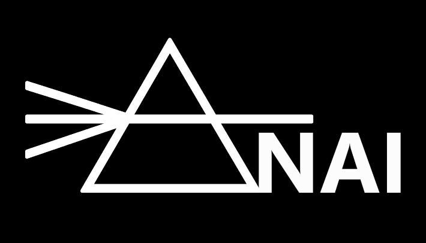
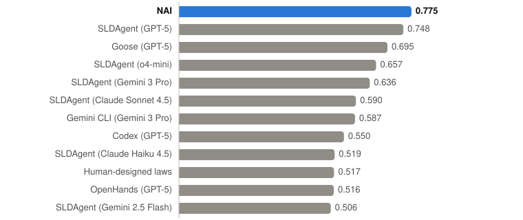
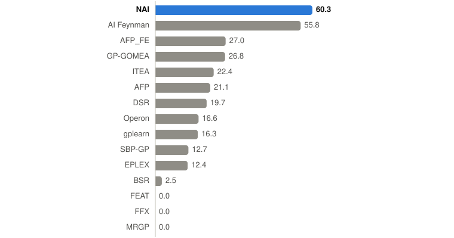
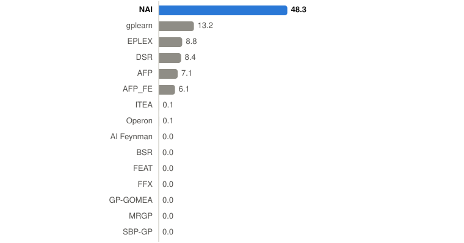
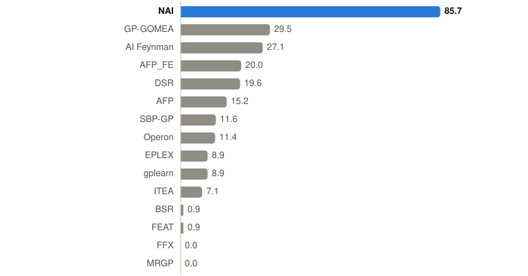
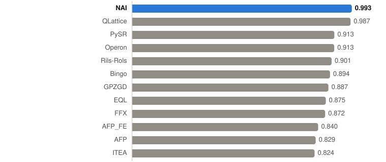
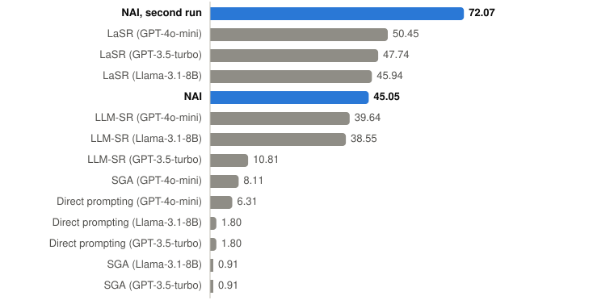
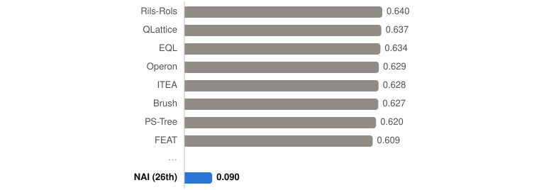

  

<a href="https://naiscience.com"><b>naiscience.com</b></a>

  
  
  
   
  
  
  

Places against the results each benchmark publishes for other systems: my own runs, not
entries of an official leaderboard. Conditions and caveats: <a href="benchmarks/">benchmarks</a>.

# NAI-track-record

The track record of the NAI (No-Ansatz Inference) system: results that began with
formulas found by NAI, and what has happened to them since. For each result the
documents say whether it has been proved, whether it has been accepted by the
editors of the OEIS or submitted to a journal, and what is still open. Preprints
and related documents on these results are collected here.

NAI is a system I develop for finding formulas that fit given data without
fixing their form in advance. NAI does not use language models. Its source code
and method are not part of this repository; each document says exactly which of its
results came from NAI and which were obtained afterwards, and by whom.

## Documents

| date | document | folder | status |
|---|---|---|---|
| October 2026 | NAI on public benchmarks: SRBench, SLDBench, OEIS, compared with other systems | [benchmarks](benchmarks/) | short reports |
| October 2026 | OEIS findings that began with NAI (history and status of the edits) | [oeis-findings](oeis-findings/) | updated as the OEIS reviews the edits |
| October 2026 | A prospective forecast: the final loss of the Marin 535B-A23B run, made while it trains | [forecasts](forecasts/marin-535b.md) | open until the run ends (about 1 December 2026); formulas sealed by SHA-256 |
| October 2026 | Hardin's Arrangements in Which Every Number Is a Sum of Others: Formulas and Sumsets | [hardin-sumsets](hardin-sumsets/) | preprint; submitted to the Journal of Integer Sequences |
| October 2026 | The whole f–I curve of a neuron from its rheobase and one current step: a pre-registered test on the Allen Cell Types Database | [neuron-fi-curves](neuron-fi-curves/) | preprint; Zenodo, DOI [10.5281/zenodo.23582787](https://doi.org/10.5281/zenodo.23582787) |

Each paper folder holds the document (PDF and LaTeX source) and a `supplement`
with the programs and data needed to check it.

## Benchmarks at a glance

NAI against the other systems reported with each benchmark; first place on top.
NAI ran on a laptop processor with no language model, one run per problem (five on
SLDBench). Conditions, caveats and what was seen during development:
[benchmarks](benchmarks/).

### SLDBench: discovering neural scaling laws

Mean R² over the 8 tasks. NAI: 0.775 ± 0.024 over five runs. Other systems: the
benchmark's published results data (five runs each; Gemini CLI and OpenHands three to
four; the human-designed laws are one law per task). The test was seen during NAI's development; see the [report](benchmarks/sldbench.md).

<picture>
  <source media="(prefers-color-scheme: dark)" srcset="benchmarks/charts/sldbench_dark.svg">
  
</picture>

### SRBench 2021: exact recovery of the Feynman equations

Share of the 116 equations recovered exactly (up to a constant term or factor),
symbolic check with positive variables; under the strict check NAI recovers 56.9 %,
still first. Other methods: SRBench's published table, mean of 10 runs (AI Feynman
over 114 equations).

<picture>
  <source media="(prefers-color-scheme: dark)" srcset="benchmarks/charts/feynman_dark.svg">
  
</picture>

### SRBench 2021: Feynman equations with 1 % noise

Strict symbolic check: NAI 45.7 %.

<picture>
  <source media="(prefers-color-scheme: dark)" srcset="benchmarks/charts/feynman_noise_dark.svg">
  
</picture>

### SRBench 2021: ODE-Strogatz systems

Share of the 14 problems recovered exactly.

<picture>
  <source media="(prefers-color-scheme: dark)" srcset="benchmarks/charts/strogatz_dark.svg">
  
</picture>

### SRBench 2025: real measurements of physical laws

Median R² over the 13 first-principles datasets; the top 12 of 28 systems. Other
systems: median over 30 tuned runs of up to an hour; NAI: one run of 120 s. By mean
R², NAI is fourth.

<picture>
  <source media="(prefers-color-scheme: dark)" srcset="benchmarks/charts/first_principles_dark.svg">
  
</picture>

### LLM-SRBench: new equations

Accuracy (Acc0.1: within 10 % of the true value on every test point) on the benchmark built for
LLM-based equation discovery, against the twelve LLM-based systems of its paper. NAI: one run
per problem, registered in advance, no language model. First in four of the five sets, third in
materials science; on LSR-Transform 35 of 111 laws recovered exactly under a strict check:
[report](benchmarks/llmsrbench.md).

| set | NAI | best other system | place of 13 |
|---|---|---|---|
| LSR-Transform | **72.07 %** | 50.45 % | **1st** |
| LSR-Synth: chemistry | **91.67 %** | 66.66 % | **1st** |
| LSR-Synth: biology | **70.83 %** | 58.33 % | **1st** |
| LSR-Synth: physics | **47.73 %** | 36.36 % | **1st** |
| LSR-Synth: materials science | 84.00 % | 88.28 % | 3rd |

<picture>
  <source media="(prefers-color-scheme: dark)" srcset="benchmarks/charts/llmsr_transform_dark.svg">
  
</picture>

### SRBench 2025: black-box regression

Mean R² over the 12 black-box datasets (R² below -1 counted as -1); the top 8 of 29
systems and NAI, 26th. These problems have no law behind them; NAI looks for laws and
is not competitive here.

<picture>
  <source media="(prefers-color-scheme: dark)" srcset="benchmarks/charts/black_box_dark.svg">
  
</picture>

## Use of AI assistants

Some of the work in these documents was done with an AI assistant (Claude,
Anthropic). Its role is stated in each document and in the folder's README,
next to the role of NAI.

## License

- Texts (documents, READMEs, preprints in PDF and LaTeX) and computed data
  (profiles, formulas, check reports): [CC BY 4.0](LICENSE-TEXT).
- Programs (the `programs` folders of the supplements): [MIT](LICENSE-CODE).
- Data taken from the OEIS (entries and b-files in the `data` folders): the OEIS
  license, [CC BY-SA 4.0](https://oeis.org/LICENSE).

## Contact

Mikhail Smirnov, lab@mindscan.org
