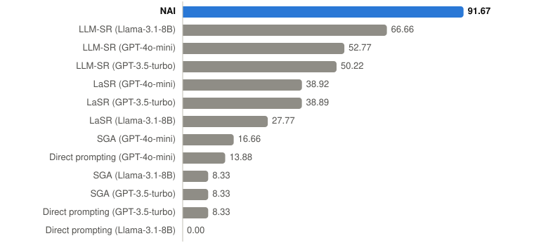
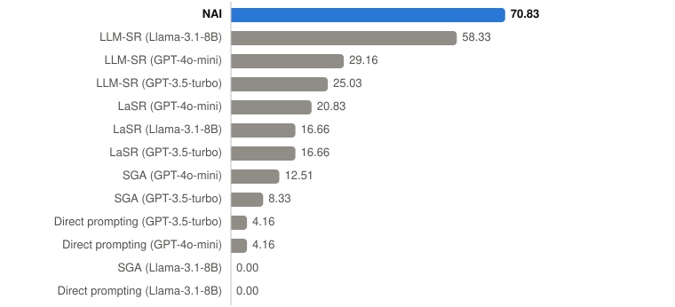
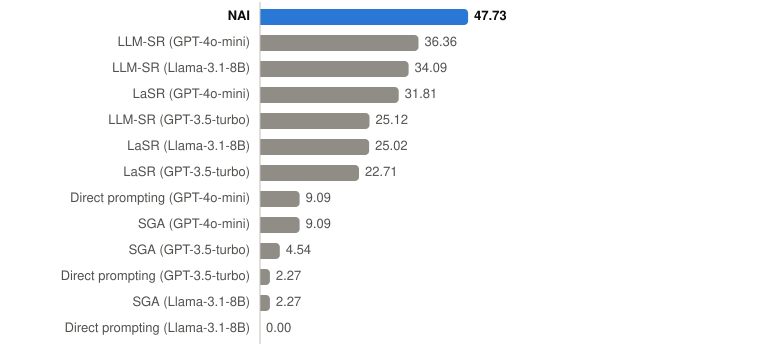
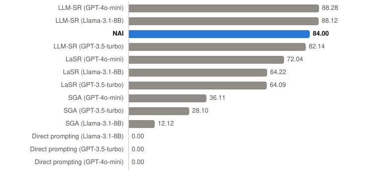

# LLM-SRBench: new equations

*October 2026. One frozen build of NAI, one run per problem, registered in advance.*

LLM-SRBench (Shojaee et al., ICML 2025) was built to test equation discovery by systems based on
large language models. Its problems are chosen so that a model cannot simply recall the answer:

- **LSR-Transform** (111 problems): Feynman's equations rewritten for another variable, with
  roots and solved equations in them; 2 to 8 inputs.
- **LSR-Synth** (129 problems): known laws of chemistry, biology, physics and materials science
  with synthetic terms added; 2 to 3 inputs, a held-out range for extrapolation.

The run, its metrics and its hypotheses were registered before it started; all three hypotheses
held.

## Result in brief

- **First by accuracy in four of the five sets:** LSR-Transform (72.07 %), chemistry (91.67 %),
  biology (70.83 %) and physics (47.73 %), ahead of all twelve LLM-based
  systems of the paper.
- **Third in materials science** (84.00 %, behind two LLM-SR variants, best 88.28 %).
- **Recovering the law itself:** on LSR-Transform 35 of NAI's 111 formulas (31.53 %) are
  symbolically identical to the true law under a strict check; the best system of the paper
  reaches the same 31.53 % on a softer, model-judged measure.
- NAI uses no language model. It gets the table and, on LSR-Transform, the units of the
  variables; nothing else.

## Conditions

- **NAI:** one frozen build, the same settings for every problem, one run per problem; 300 s per
  problem on a laptop processor (6 threads); at most 2 000 training rows, a random sample; the
  test and the out-of-range sets in full.
- **What the tables carry:** the measurements; on LSR-Transform the standard units of the
  variables (Feynman's equations; the systems of the paper get descriptions of the variables in
  their prompts); on every set a column with the precision of the data, which the benchmark
  stores as float32 (about 7 digits). The same rules for every problem, nothing set per problem.
- **Other systems:** the numbers published in the paper's main table: Direct prompting, SGA, LaSR
  and LLM-SR, each with Llama-3.1-8B, GPT-3.5-turbo and GPT-4o-mini.
- **Accuracy (Acc0.1):** the share of problems where the formula is within 10 % of the true value
  on every test point, as in the benchmark's own pipeline.
- **Looks at the test:** this is my second evaluation on these data; an earlier run with an older
  build of NAI preceded it.

## Accuracy, Acc0.1 (%)

| set | problems | NAI | best other system | NAI's place of 13 |
|---|---|---|---|---|
| LSR-Transform | 111 | **72.07** | 50.45 (LaSR, GPT-4o-mini) | **1st** |
| LSR-Synth: chemistry | 36 | **91.67** | 66.66 (LLM-SR, Llama-3.1-8B) | **1st** |
| LSR-Synth: biology | 24 | **70.83** | 58.33 (LLM-SR, Llama-3.1-8B) | **1st** |
| LSR-Synth: physics | 44 | **47.73** | 36.36 (LLM-SR, GPT-4o-mini) | **1st** |
| LSR-Synth: materials science | 25 | 84.00 | 88.28 (LLM-SR, GPT-4o-mini) | 3rd |

**LSR-Transform:**

<picture>
  <source media="(prefers-color-scheme: dark)" srcset="charts/llmsr_transform_dark.svg">
  
</picture>

**LSR-Synth, chemistry:**

<picture>
  <source media="(prefers-color-scheme: dark)" srcset="charts/llmsr_chem_dark.svg">
  
</picture>

**LSR-Synth, biology:**

<picture>
  <source media="(prefers-color-scheme: dark)" srcset="charts/llmsr_bio_dark.svg">
  
</picture>

**LSR-Synth, physics:**

<picture>
  <source media="(prefers-color-scheme: dark)" srcset="charts/llmsr_phys_dark.svg">
  
</picture>

**LSR-Synth, materials science:**

<picture>
  <source media="(prefers-color-scheme: dark)" srcset="charts/llmsr_matsci_dark.svg">
  
</picture>

## Recovering the law itself

The paper measures symbolic accuracy with GPT-4o, which compares the forms of the two equations
without their constants. I used a strict check instead: the difference or the ratio of NAI's
formula and the true one must simplify to a constant in sympy, as in SRBench.

| set | NAI, strict check | best of the paper, model-judged |
|---|---|---|
| LSR-Transform | 31.53 % (35 of 111) | 31.53 % (LLM-SR, GPT-4o-mini) |
| LSR-Synth: biology and materials science | 0 of 49 | 25.30 % and 28.12 % |

On LSR-Transform NAI declares 45 of the 111 problems solved exactly and 8 more fitted to within
the precision of the data. On LSR-Synth the true laws contain synthetic terms; NAI finds formulas
of another form that fit the data almost exactly (normalised error below 10⁻¹⁰ on 49 of the 129
problems) and are not the reference form, so the strict check accepts none of them in biology
and materials science.

## Notes on the run

- **No deviations from the registration.** The build, the harness and the registration were
  checked against their SHA-256 fingerprints after the run.
- **Column names:** in materials science the quantity to explain is called `sigma`, a name NAI's
  table format reserves for standard errors; the harness renames it, as it would for any table.
- **The symbolic check** is limited to 60 s per formula, as in SRBench; an unfinished check
  counts as no match.
- **Normalised errors** (NMSE) are not compared here: I have not checked how the paper aggregates
  them over the problems.

## Reproduction

NAI's outputs on these problems are not published. A compiled build of NAI that runs these
problems, or any other table, is available on request: lab@mindscan.org.

Benchmark: Shojaee, P., Nguyen, N.-H., Meidani, K., Farimani, A. B., Doan, K. D., Reddy, C. K.
*LLM-SRBench: A New Benchmark for Scientific Equation Discovery with Large Language Models.*
ICML 2025. arXiv:2504.10415.
